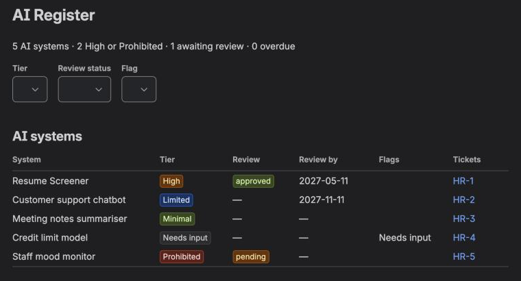
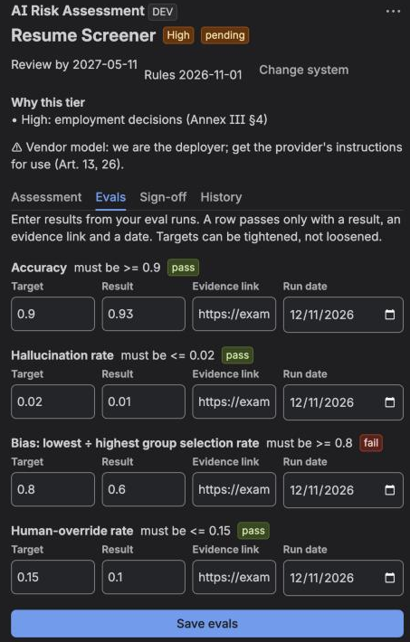
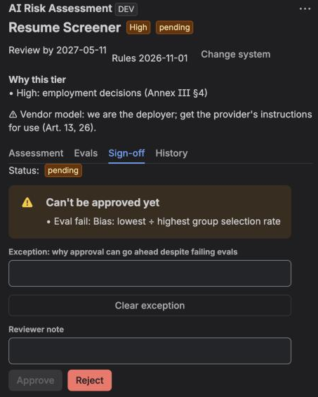
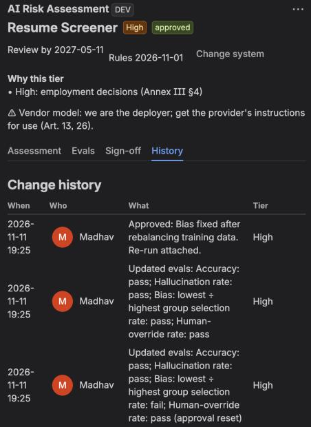
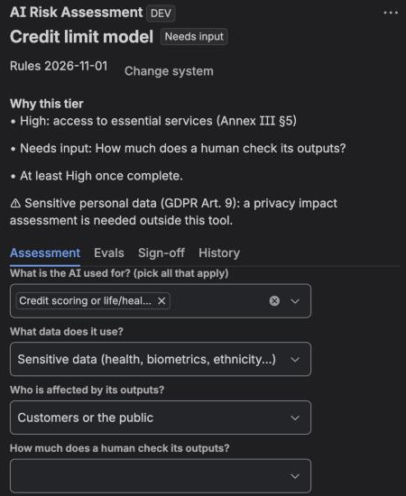
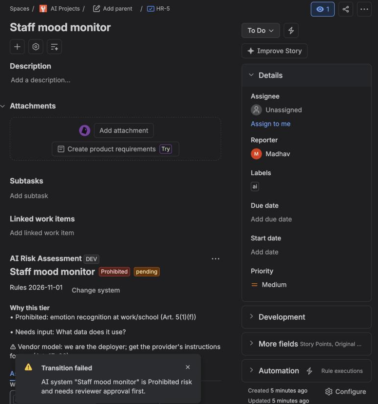

# Tierwise

Tierwise is a Jira app that keeps track of every AI system a team builds and how risky it is under the EU AI Act.

You answer six questions about the system and it gives you a tier with the reason behind it. If the system is high risk, it can't ship until the evals pass and someone from compliance signs off. Jira itself won't let the ticket close before that.

I built this to showcase I think about AI governance, evals and product decisions, and I wanted it running in a real tool rather than as a slide.



This is the register page. Every AI system in the company gets one row, with its tier, review status, when it's due for review, and the tickets linked to it.

## Why I built it

Most teams I've seen handle AI risk in a spreadsheet that someone fills in once and nobody opens again. The work itself happens in Jira, so the risk check should live there too, right next to the tickets.

I came across a Jira Marketplace app doing a simple version of this. It's a questionnaire on each ticket that gives you a risk tier. I liked the idea but wanted to push it further. I wanted to track systems instead of tickets, make evals part of it, and add a sign-off that actually blocks something.

## How it works

Say a team is building a resume screener. Hiring is listed in Annex III of the AI Act, so it comes out as High risk.

| | |
|---|---|
| **The evals have to pass.** High risk means you need numbers for accuracy, hallucination rate, bias across groups and how often humans override it. A result alone doesn't count. You need a link to the eval run and a date as well. Here the bias ratio is 0.6, and the target is 0.8. |  |
| **So the reviewer can't approve it.** The Approve button stays off until every eval passes. The only other way through is to log an exception and write down why. |  |
| **Fix it, re-run, approve.** Bias goes up to 0.85, and the reviewer approves it with a note. Everything goes into the history, including the fact that changing an eval undid the earlier approval. |  |
| **"Not sure" is allowed, but it doesn't let you through.** One answer is missing for this credit model, so it shows Needs input. It also says "at least High once complete", so nobody reads it as low risk. |  |
| **Jira enforces it.** An AI ticket can't move to Done until its system has been assessed, and approved too if it's High or Prohibited. |  |

## How the tier gets decided

| If the system is used for | Tier | Where it comes from |
|---|---|---|
| Social scoring, manipulation, emotion recognition at work or school | Prohibited | Article 5 |
| Hiring, education, credit or insurance, biometrics, critical infrastructure | High | Annex III |
| A chatbot, generated content, or anything outside users talk to directly | Limited | Article 50 (you have to tell people it's AI) |
| Internal tools, recommendations, spam filtering | Minimal | Nothing specific |
| Any question answered "Not sure" or left blank | Needs input | |

If a system does more than one thing, the highest tier wins.

High-risk systems come up for review every 6 months and limited ones every 12. Every assessment saves the version of the rules it was done under. So if the rules change, older assessments get flagged for a re-check.

## Decisions I made

**I track systems, not tickets.** One model can touch twenty tickets. If you assess each ticket separately, you end up with the same model rated three different ways.

**"Not sure" blocks progress.** I'd rather surface a gap than have someone pick Minimal just to get past the form.

**Every tier comes with a reason.** It names the article or annex it's based on, so a reviewer can disagree with something specific.

**A number on its own isn't enough for an eval.** It needs a link and a date. Teams can make a target stricter, but they can't loosen it.

**Changing anything after approval sends it back for review.** That covers the answers, the evals and the exception.

**All the rules live in one file.** It's [`src/rules.js`](src/rules.js), and it's short enough for a compliance person to read through in one go.

## What I left out

| What | Why |
|---|---|
| AI filling in the answers | The whole point is that a person owns the assessment. Autofill makes it too easy to just click through. |
| Detecting AI tickets from their text | A label is clear and you can audit it. Guessing isn't. |
| Rules for other countries | EU AI Act only. I'd rather do one properly. |
| A screen for editing the rules | For now the rules are code with tests. A UI makes sense once there's an actual owner for them. |
| Email reminders, CSV export, searching by tier, pulling eval results in automatically | All useful, but none of them change whether the core flow works. They're next if I take it further. |

## Where it falls short

- The answers and eval numbers are self-reported. Tierwise checks that there's an evidence link, not what the link actually shows.
- Jira's free plan doesn't support custom permissions, so the app keeps its own list of reviewers.
- The rules need someone to keep them current as the AI Act guidance changes.
- It's a guide. It isn't legal advice.

## How it's built

It runs on Atlassian Forge, so there's no separate server, and the data stays in Forge's own storage.

| Part | File |
|---|---|
| Questions, tiers, eval templates, review periods | [`src/rules.js`](src/rules.js) |
| Tests (12, including the resume screener story end to end) | [`test/rules.test.js`](test/rules.test.js) |
| Backend: storage, sign-off, history, the workflow rule | [`src/index.js`](src/index.js) |
| The panel on each ticket | [`src/frontend/panel.jsx`](src/frontend/panel.jsx) |
| The register page | [`src/frontend/register.jsx`](src/frontend/register.jsx) |

To run the tests:

```bash
npm test
```

<details>
<summary><b>Setting it up on your own Jira</b></summary>

1. Make a free Jira Cloud site and a **company-managed** Scrum space. Team-managed spaces won't let you add the workflow rule.
2. Create an API token at id.atlassian.com/manage-profile/security/api-tokens.
3. Install the Forge CLI and log in:
   ```bash
   npm install -g --allow-scripts=@forge/cli,cloudflared,keytar @forge/cli
   ```
   ```bash
   forge login
   ```
4. Register, deploy and install:
   ```bash
   forge register
   ```
   ```bash
   forge deploy
   ```
   ```bash
   forge install --site <your-site>.atlassian.net --product jira
   ```
5. Add yourself as a reviewer (your accountId), then deploy again:
   ```bash
   forge variables set REVIEWERS <accountId>
   ```
6. Add the rule: **Space settings → Workflows → edit → the "Done" transition → Validate details → + → "AI ticket has an assessed AI system"**, then **Update workflow**.
7. A ticket counts as AI if it has the `ai` label, or if you add a "Uses AI?" field and set it to Yes.

</details>
